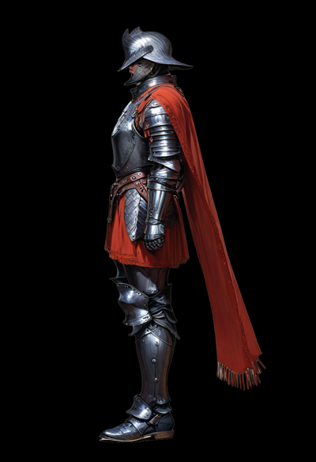
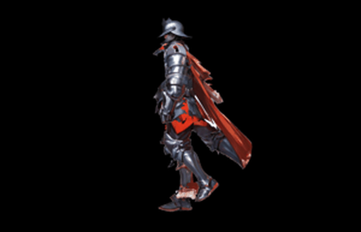
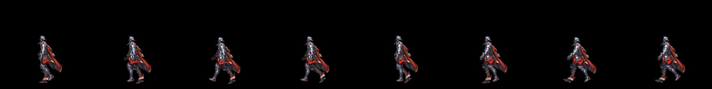
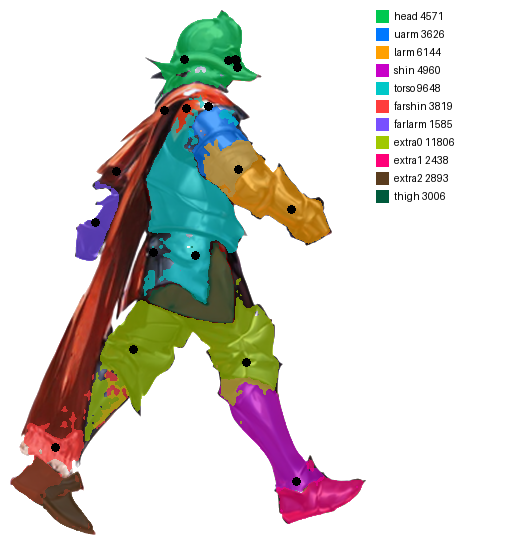
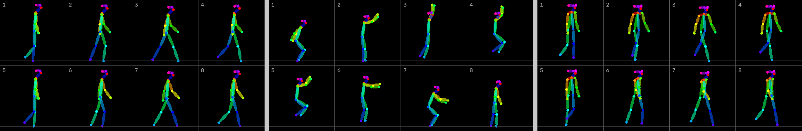
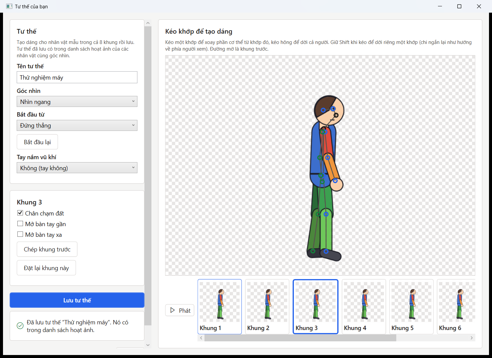

# AnimGen: offline 2D character animation generator

**One character image in, Unity-ready 8-frame sprite sheets out. Runs fully offline on an 8 GB laptop GPU.**

<table>
<tr>
<td align="center"><br><sub>Input: one side-view character image</sub></td>
<td align="center"><br><sub>Output: walk cycle, 8 frames</sub></td>
</tr>
</table>


<sub>Exported sprite sheet: one row of 8 frames, imported straight into Unity.</sub>

## Why I built it

I make my mobile games alone, and character animation was the slowest part of my pipeline. AI image tools that draw
every frame from scratch change the character's face, armour and colours between frames, and their output arrives
all at once, so the clean-up takes longer than the animation itself.

AnimGen takes the opposite approach. It **does not redraw the character**. It cuts the original art into layered body
parts, rigs them to a skeleton and poses them like a puppet, so every frame keeps the exact pixels of the original
design. AI is used only for the jobs it is good at, and the user can check and correct the result after every step.

## How it works

| Step | What happens | What the user can do |
| --- | --- | --- |
| 1. Character | Removes the background, detects an 18-point skeleton (DWPose) and the view (side or 3/4) | Drag joints to correct the skeleton |
| 2. Part map | Splits the character into body-part layers (SAM 2, clothes parsing) and rebuilds the sections hidden behind other parts | Fix the part map in Photoshop and reload it |
| 3. Animation | Picks a motion template and previews it as a live loop | Choose from 20+ templates or pose your own |
| 4. Generate | Poses the layered rig into 8 frames in seconds, with squash and stretch | Optional AI finishing pass (SDXL + ControlNet), about 25 s per frame |
| 5. Export | Writes transparent PNG frames, a sprite sheet and hand anchor points | Import in Unity: *Sprite Mode Multiple*, *Grid By Cell Count* 1 × 8 |

<p align="center">

<br><sub>Step 2: the part map cut from the original image. Each colour is one layer of the rig.</sub>
</p>


<sub>Motion templates (walk, jump, three-quarter walk), stored as joint angles and fitted to each character's proportions.</sub>

### Pose editor

Users can create their own animations: drag a joint to rotate the limb below it, drag the hips to move the whole
body, and see the previous frame as an onion skin. Saved poses appear in the animation list for every character with
the same view.



### Weapons

Weapons are separate images placed by the app at the character's grip and tip points, never redrawn by the AI. Each
weapon can have several colour skins, and bows have three draw stages (rest, half drawn, fully drawn).

## Architecture

```
WPF desktop app (C#, .NET 9)  ──  local HTTP + token  ──  Python backend process
  views, view models, theme                                 skeleton fitting, part map, rig,
  starts / stops the backend                                templates, frame validation, export
  progress, cancel, errors                                  AI engines: DWPose, SAM 2, BiRefNet / ToonOut,
                                                            SDXL (Animagine XL 4.0) + ControlNet + IP-Adapter
```

- The UI never runs inference. It starts the backend as a child process, talks to it over a loopback API protected
  by a random token, and shows progress, cancel and explicit errors, so long jobs never freeze the window.
- Models are loaded with group offloading so the SDXL pipeline fits in **8 GB of VRAM** (tested on an RTX 4060 Laptop
  GPU with 16 GB RAM).
- Everything runs locally. After installation the tool needs no internet connection and calls no remote AI service.
- The interface is in Vietnamese.

## Repository layout

```
app/AnimGen/          WPF app: Views, ViewModels, Services (backend process, HTTP client), Themes
backend/animgen/      Python backend
  server.py           loopback HTTP API (token, tasks, progress, cancel)
  skeleton.py         18-point skeletons, fitting to the character
  parts.py, rig.py    part map and the layered cut-out rig
  puppet.py, cloth.py posing the rig, cloth that settles
  templates.py        motion templates (joint angles per frame)
  frames.py, export.py  frame validation, PNG frames, sprite sheets
  engines/            demo engine (CPU) and real engine (Diffusers, DWPose)
backend/tests/        pytest suite, 148 tests, no GPU needed
scripts/              runtime setup, model download, publish
docs/                 design document, decision log, test notes
```

## Running it

**Tests (any OS, no GPU):**

```
cd backend
pip install -r requirements-dev.txt
python -m pytest -q
```

**On Windows with an NVIDIA GPU:**

1. `scripts\setup_runtime.ps1 -Data C:\AnimGen -Uv <path to uv.exe>`: installs Python, PyTorch and the models
   (internet needed once, about 15 GB).
2. `scripts\publish.ps1 -Data C:\AnimGen`: builds the app (needs the .NET 9 SDK).
3. Start `C:\AnimGen\AnimGen.cmd`. `AnimGen (thu, khong AI).cmd` starts a demo engine that runs without a GPU.

AI models are **not** included in this repository. `scripts/download_models.py` downloads them from their official
sources. Each model has its own licence, and some allow non-commercial use only. Check them before using the output
commercially.

## Development notes

I designed the workflow and made every design decision, and I tested each step on my own hardware and art. I wrote
the code with Claude Code as an AI pair programmer. The reasoning behind each choice is recorded in
[docs/DECISIONS.md](docs/DECISIONS.md), and the full design is in [docs/DESIGN.md](docs/DESIGN.md).

**Known limitations:** the tool only handles one human-shaped character per image, in a standing pose. Loose cloth
can occasionally land in the wrong layer. The optional AI finishing pass can swap left and right limbs.

## Author

**Nguyen Ngoc Thach**, Unity game developer and game development student at VTC Academy.
My games on Google Play: [the stone](https://play.google.com/store/apps/developer?id=the%20stone)
